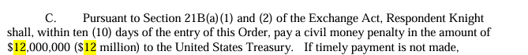

# Caça ao desastre: Knight Capital (2012)

**Estudante:** João Paulo de Albuquerque Alves
**Disciplina:**  Teste e Qualidade de Software, ADS, IFCE Campus Boa Viagem
**Unidade I:** Fundamentos da qualidade de software

---

## 1. Resumo do caso

Em 1º de agosto de 2012, na Bolsa de Valores de Nova York (NYSE), a corretora Knight Capital sofreu um desastre operacional quando uma atualização manual no SMARS — seu sistema automatizado de roteamento de ordens — deixou 1 de seus 8 servidores sem o novo código, reativando acidentalmente um algoritmo obsoleto (Power Peg) que executou mais de 4 milhões de negociações errôneas em loop ao longo de apenas 45 minutos. Essa falha gerou um prejuízo direto de US$ 440 milhões, destruiu mais de 75% do valor de mercado da empresa em dois dias e custou uma multa de US$ 12 milhões aplicada pela SEC, levando à perda de empregos, ao afastamento da liderança executiva e ao fim da companhia como entidade independente após ser vendida às pressas para a Getco

## 2. Linha do tempo

| Data | Evento |
|---|---|
| [2003] | [Desenvolvimento da funcionalidade Power Peg no SMARS (posteriormente desativada, mantendo o código morto no sistema).] |
| [27–31 de Julho de 2012] | [Deploy manual do RLP em 8 servidores de produção, omitindo acidentalmente o 8º servidor.] |
| [1 de Agosto de 2012] | [O servidor desatualizado entra em loop infinito na abertura do mercado, gerando 4 milhões de ordens erróneas e um prejuízo de US$ 440 milhões em 45 minutos.] |
| [Dezembro de 2012] | [Em crise financeira severa, a Knight Capital aceita a oferta de fusão/aquisição pela Getco.] |
| [Outubro de 2013] | [SEC aplica multa de US$ 12 milhões e o setor adota novas exigências de kill switches e governança de software.] |

## 3. Causa técnica

O defeito no software da Knight Capital foi uma imperfeição estática no código-fonte do sistema SMARS, caracterizada pelo acúmulo de código morto desativado em 2003 (Power Peg) e pela reutilização imprudente de uma mesma variável (flag) para ativar a nova funcionalidade do programa RLP em 2012; já a falha foi a manifestação dinâmica desse defeito em produção, que ocorreu quando o servidor desatualizado interpretou a nova flag sob o código antigo e disparou um loop infinito e descontrolado de compra e venda de ações na bolsa, resultando na execução errônea de 4 milhões de ordens e em um prejuízo de US$ 440 milhões em apenas 45 minutos.

## 4. Análise com os conceitos da Unidade I

### 4.1 Verificação e validação

A falha do caso Knight Capital decorreu de ambos os fatores: houve uma falha de verificação porque a equipe de infraestrutura não garantiu a correta implementação do plano de deploy, omitindo a atualização do código no 8º servidor e deixando de realizar testes pós-implantação que checassem a integridade dos binários em produção, e ocorreu simultaneamente uma falha de validação porque as especificações do software foram incompletas e inadequadas à necessidade real do negócio de alta frequência (HFT), uma vez que não exigiram a remoção do código morto (Power Peg) desativado em 2003, permitiram o reuso de flags legadas e omitiram mecanismos indispensáveis de segurança, como limites de risco por volume e disjuntores automatizados (kill switches) independentes da aplicação.

### 4.2 Garantia da qualidade (QA) e controle da qualidade (QC)

*Que atividade preventiva de processo (QA) faltou ou falhou? Que atividade de detecção no produto (QC), como revisão, inspeção ou teste, poderia ter encontrado o defeito?*

[escreva aqui]

### 4.3 Custo da não qualidade

*Classifique os custos do caso pelo modelo PAF. Nas linhas de falha, use os custos reais do caso. Nas linhas de prevenção e avaliação, descreva o que poderia ter sido investido.*

| Categoria | O que aconteceu ou o que poderia ter sido feito | Custo (se conhecido) |
|---|---|---|
| Prevenção | [ ] | [ ] |
| Avaliação | [ ] | [ ] |
| Falha interna | [ ] | [ ] |
| Falha externa | [ ] | [ ] |

### 4.4 Visões de Garvin

*Qual visão de qualidade (transcendental, usuário, fabricante, produto, valor) foi priorizada por quem desenvolveu ou decidiu? Qual visão foi ignorada? Justifique com fatos do caso.*

[escreva aqui]

### 4.5 Produto ou processo?

*O problema foi principalmente de qualidade de produto, de qualidade de processo, ou dos dois? Quais características da ISO/IEC 25010 foram afetadas (ex.: adequação funcional, confiabilidade, segurança)?*

[escreva aqui]

## 5. O que poderia ter evitado a falha

*Liste de 2 a 4 práticas de qualidade concretas e explique como cada uma teria evitado ou reduzido o problema.*

1. [prática]: [como teria ajudado]
2. [prática]: [como teria ajudado]

## 6. O que a IA errou ou não sabia

*Liste as afirmações relevantes que a IA fez sobre o caso e o resultado da sua checagem. Mínimo de 6 afirmações. Classificação: **Confirmada**, **Errada**, **Imprecisa** ou **Não verificável**.*

| # | Afirmação da IA | Classificação | O que a fonte diz | Fonte |
|---|---|---|---|---|
| 1 | [Causa Técnica: Código Morto (Reused Flag) O sistema SMARS possuía uma funcionalidade antiga (chamada Power Peg), desativada anos antes em 2003, mas cujo código interno nunca fora removido por completo. A nova funcionalidade para o programa RLP reutilizou a mesma flag (parâmetro) que no passado ativava o Power Peg. ] | [Confirmada ] | [ O código RLP reutilizou uma bandeira que antes era usada para ativar uma função antiga conhecida como 'Power Peg'. Ordens enviadas com a bandeira reaproveitada para o oitavo servidor acionaram o código Power Peg defeituoso ainda presente naquele servidor.] | [Wikipedia ] |
| 2 | [Horário do ocorrido: 1º de agosto de 2012, logo na abertura do mercado, entre 09:30 e 10:15 (horário local). ] | [Não verificavel ] | [Menciona data, mas não horário estimado ] | [Wikipedia ] |
| 3 | [ Multa de US$ 12 milhões aplicada pela SEC por descumprimento da Market Access Rule.] | [Confirmada ] | [ ] | [FEC ] |
| 4 | [ ] | [ ] | [ ] | [ ] |
| 5 | [ ] | [ ] | [ ] | [ ] |
| 6 | [ ] | [ ] | [ ] | [ ] |

[Baseado no trabalho desenvolvido, dá pra confiar na IA como uma grande biblioteca digital, ela trás dados de forma rápida mas nem sempre precisa, dá pra confiar mas não cegamente. utilizando-a como parceira em estudos, projetos de pesquisa amplia e agiliza o desenvolvimento de atividades]

## 7. Fontes

ESTADOS UNIDOS. Securities and Exchange Commission (SEC). Administrative Proceeding File No. 3-15570: In the Matter of Knight Capital Americas LLC (Release No. 34-70694). Washington, D.C., 16 out. 2013. Disponível em: https://www.sec.gov/files/litigation/admin/2013/34-70694.pdf. Acesso em: 11 out. 2026.

SECURITIES AND EXCHANGE COMMISSION (SEC). Administrative Proceeding Release No. 34-70694: In the Matter of Knight Capital Americas LLC. Washington, D.C.: SEC, 16 out. 2013. Disponível em: https://www.sec.gov/files/litigation/admin/2013/34-70694.pdf. Acesso em: 11 out. 2026.

SOUZA, Renato William Rodrigues de. Fundamentos da Qualidade de Software. Unidade I, Aula 1. Boa Viagem: IFCE Campus Boa Viagem, 2026. Material didático da disciplina de Qualidade de Software.